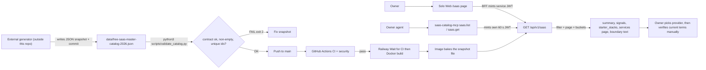

# 01 — Business process (As-Is / To-Be)

repo นี้คือ read-only HTTP API (Python stdlib `http.server`) ที่แบ่งหน้าและกรอง JSON snapshot ไฟล์เดียว `data/free-saas-master-catalog-2026.json` ให้โมดูล `/saas` ของ Solo Web (`bookchaowalit/life-dashboard-web`) และ MCP server `saas-catalog-mcp` ของ owner ไม่มี database, ไม่เรียก provider, ไม่ activate อะไร (ดู [`PRODUCT.md`](../../PRODUCT.md))

Last reviewed: 2026-11-27 · commit `a9e2747`

## As-Is (จากโค้ดวันนี้)

ขั้นตอน "verify current terms" อยู่นอกระบบ: payload มีแค่ข้อความ `boundary` ว่า "verify current limits and terms before activating any provider" ระบบไม่บันทึกว่า verify แล้วหรือยัง

Sources: `server.py`, `scripts/validate_catalog.py`, `Dockerfile`, `.railway/railway.ts`, `saas_catalog_mcp.py`, `README.md`, `PRODUCT.md`, `contracts/saas-catalog.v1.md`, Solo Web `lib/backends.ts` + `modules/saas/api.ts` (life-dashboard-web `09c1001`, read-only)

## To-Be

ไม่มี To-Be ที่เขียนไว้ (`specs/001-l2-baseline/spec.md` เป็น tooling baseline ไม่ใช่ process ใหม่; ไม่มี `docs/UPGRADE-PLAN.md`; `PRODUCT.md` ระบุเพียงคำถามที่ยังเปิดและ Measures ที่ยังไม่มีเป้า)

## Gap

| ID | As-Is → To-Be | Status | Owner | Evidence |
|---|---|---|---|---|
| G1 | ไม่มี To-Be เขียนไว้ → owner กำหนดเป้าหมายของ catalog | decide | owner | ขอให้ owner เขียน To-Be (spec หรือ `PRODUCT.md`) |
| G2 | ไม่ทราบว่าใครและบ่อยแค่ไหนที่ refresh snapshot (data แก้ครั้งเดียวใน 90 วัน, `scripts/sync_catalog.py` ถูกลบ) → ผู้รับผิดชอบและรอบ refresh ที่ชัดเจน | decide | owner | `PRODUCT.md` [ต้องยืนยัน]; commit `fd1b37a`, `0fc3fe7` |
| G3 | ไม่มีเป้า snapshot age และสัดส่วน `verify` rows → เป้าที่วัดได้ | decide | owner | `PRODUCT.md` (Measures: no target set) |

## Open questions

- ใครเป็นคน refresh snapshot และบ่อยแค่ไหน (`PRODUCT.md` เขียนว่า "[ต้องยืนยัน]"); ใน 90 วันไฟล์ data ถูกแก้ครั้งเดียว (`fd1b37a`, 2026-10-11) และ `scripts/sync_catalog.py` ถูกลบใน `0fc3fe7`
- เป้าหมายของ snapshot age และสัดส่วน `verify` rows ("[ต้องยืนยัน: no target set]" ใน `PRODUCT.md`)
- To-Be process ทั้งหมด: owner ต้องกำหนด
