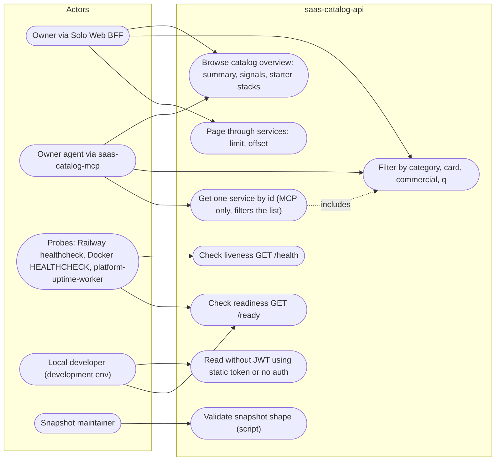

# 02 — Use cases

Actors มาจากระดับ auth ในโค้ดจริง: ไม่มี auth (`/health`, `/ready`, `OPTIONS`), JWT scope `saas:read` ที่ `tenant_id=owner` และ `sub` อยู่ใน allowlist (production), และ static bearer / ไม่มี auth เลย (development เท่านั้น เมื่อไม่ได้ตั้ง `SAAS_CATALOG_API_AUTH_*`)

| Actor | Auth ในโค้ด | Use cases |
|---|---|---|
| Owner (Solo Web BFF) | RS256 JWT, `aud=saas-catalog-api`, `scope=saas:read`, `tenant_id=owner`, allowlisted `sub` (`service_auth.AuthPolicy.authenticate`) | UC1–UC3 |
| Owner agent (MCP) | JWT เดียวกัน mint เองอายุ 60 s หรือ `EMPIRE_TOKEN` (`saas_catalog_mcp.mint`) | UC1, UC2, UC4 |
| Probes | ไม่มี | UC5, UC6 |
| Local developer | `environment=development` และ policy ไม่ configured: ใช้ `SAAS_CATALOG_API_TOKEN` ถ้าตั้ง ไม่งั้นไม่มี auth (`check_read_auth`) | UC8 |
| Snapshot maintainer | ไม่เกี่ยวกับ API (CLI script) | UC7 |

ไม่มี use case เขียน: `/api/v1/saas` ที่ไม่ใช่ GET ได้ 405 `method_not_allowed` (หลังผ่าน auth)

Sources: `server.py` (`SaasCatalogApi.handle`, `_check_read_auth`), `vendor/service-auth/service_auth/__init__.py`, `saas_catalog_mcp.py`, `scripts/validate_catalog.py`, `.railway/railway.ts`, `Dockerfile`, `PRODUCT.md`, platform-uptime-worker `src/targets.ts` (read-only)

## Open questions

- Snapshot maintainer เป็นคนหรือ job อะไร (ดู 01)
