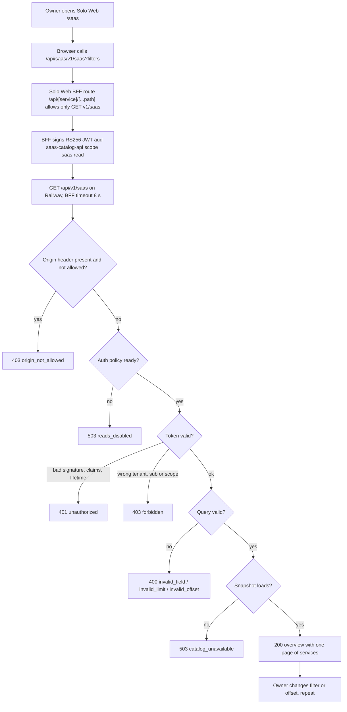
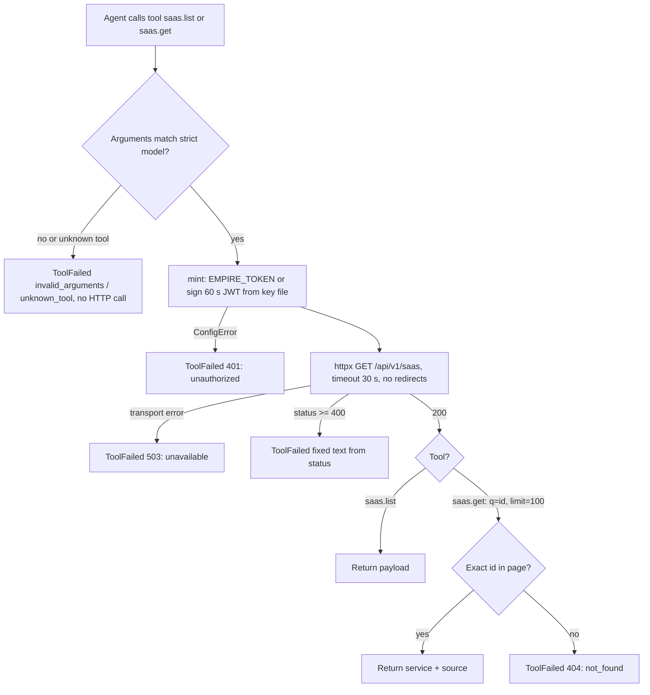
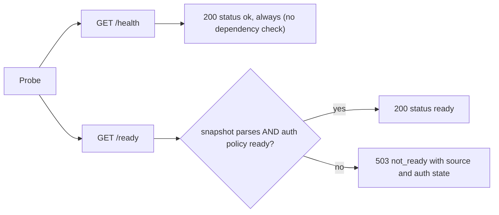

# 03 — User flows

API ไม่มีหน้าเว็บ flow ด้านล่างจึงเป็น journey ของแต่ละ role ผ่าน route จริง

## Flow A — Owner บนหน้า /saas ของ Solo Web

Sources: `server.py` (`_dispatch`, `handle`, `_overview`, `query_value`, `bounded_int`), `vendor/service-auth/service_auth/__init__.py`, Solo Web `lib/backends.ts`, `lib/auth.ts`, `modules/saas/api.ts` (life-dashboard-web `09c1001`, read-only)

## Flow B — Owner agent ผ่าน MCP

Sources: `saas_catalog_mcp.py` (`StrictMCPServer.call_tool`, `Toolbox.call`, `build_server`, `mint`, `main`), `.mcp.json`, `tests/test_mcp.py`

## Flow C — Probe / operator

Sources: `server.py`, `vendor/service-auth/service_auth/__init__.py` (`readiness`), `.railway/railway.ts`, `Dockerfile`

## Open questions

- ไม่มี retry ในทุก flow (BFF, MCP, server) ตามโค้ดที่อ่าน; ถ้า Railway serverless ตื่นช้ากว่า 8 s BFF จะ timeout หรือไม่ ยังไม่ได้วัด
