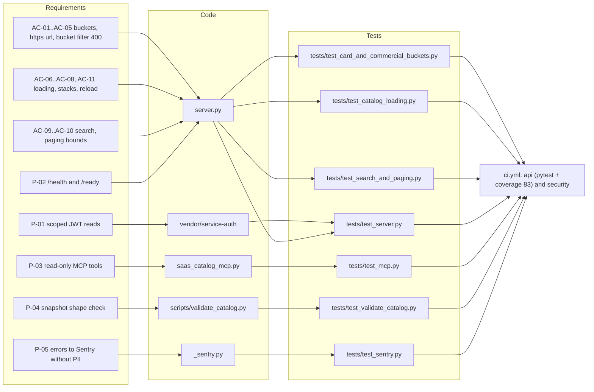

# 04 — Traceability (RTM)

Requirement มาจาก [`specs/001-l2-baseline/spec.md`](../../specs/001-l2-baseline/spec.md) (AC-01..AC-11) และ capability ใน [`PRODUCT.md`](../../PRODUCT.md) / [`contracts/saas-catalog.v1.md`](../../contracts/saas-catalog.v1.md) (ใช้รหัส P-xx ในเอกสารนี้เท่านั้น ไม่ใช่รหัสทางการ) Release = GitHub `CI` workflow (`.github/workflows/ci.yml`) แล้ว Railway deploy จาก `main` หลัง CI ผ่าน

| Req | Statement (ย่อ) | Code | Test | Release gate |
|---|---|---|---|---|
| AC-01 | "No" เท่านั้นที่เป็น `no_card` | `server.py` `card_bucket` | `test_card_and_commercial_buckets.py::test_only_a_plain_no_counts_as_no_card` | CI `api` |
| AC-02 | ข้อความไม่ชัดเป็น `verify` | `card_bucket` | `::test_anything_unclear_is_verify_never_card_free` | CI `api` |
| AC-03 | commercial `yes` เฉพาะ "Yes" | `commercial_bucket` | `::test_commercial_use_is_yes_only_when_the_catalog_says_exactly_yes` | CI `api` |
| AC-04 | เก็บเฉพาะ https url ตัดที่ 300 | `project_service` | `::test_only_https_official_urls_are_kept_and_cut_to_300` | CI `api` |
| AC-05 | bucket filter ไม่รู้จัก = 400 | `_overview` | `::test_an_unknown_bucket_filter_is_a_400` | CI `api` |
| AC-06 | contract ผิด / id ซ้ำ = 503 | `CatalogStore.snapshot` | `test_catalog_loading.py::test_duplicate_service_ids_are_a_503_not_a_partial_list`, `::test_a_catalog_with_another_contract_is_a_503` | CI `api` |
| AC-07 | dash/blank ใน stack เป็น null | `CatalogStore.snapshot` | `::test_starter_stack_dashes_and_blanks_become_null_and_text_is_cut` | CI `api` |
| AC-08 | reload เมื่อ mtime เปลี่ยนเท่านั้น | `CatalogStore.snapshot` | `::test_the_catalog_reloads_only_when_its_mtime_changes` | CI `api` |
| AC-09 | `q` ค้น 5 field | `_overview` | `test_search_and_paging.py::test_text_search_covers_id_name_subcategory_use_case_and_replaces_only` | CI `api` |
| AC-10 | ขอบเขต paging/filter = 400 | `bounded_int`, `query_value` | `::test_out_of_range_paging_and_oversized_filters_are_a_400` | CI `api` |
| AC-11 | snapshot ที่ ship โหลดได้ | `CatalogStore` | `test_catalog_loading.py::test_the_shipped_snapshot_loads_with_unique_ids` | CI `api` |
| P-01 | JWT RS256 scope `saas:read` ใน production; static token เฉพาะ dev | `service_auth.check_read_auth`, `AuthPolicy` | `test_server.py::test_scoped_production_auth_and_safe_errors`, `::test_static_token_is_never_production_authorization`; `vendor/service-auth/tests/test_auth.py` (ไม่อยู่ใน `testpaths` ของ CI) | CI `api` |
| P-02 | `/ready` 200 เฉพาะ snapshot + auth พร้อม; non-loopback ต้องมี auth | `readiness`, `main` | `test_server.py::test_readiness_and_remote_bind_fail_closed` | CI `api`, Railway healthcheck `/ready` |
| P-03 | MCP read-only, ไม่มี identity argument, error ตายตัว | `saas_catalog_mcp.py` | `tests/test_mcp.py` (19 test functions) | CI `api` |
| P-04 | validator ของ snapshot | `scripts/validate_catalog.py` | `tests/test_validate_catalog.py` | CI `api` (ตัว script ไม่ได้ถูกรันเป็น step แยก) |
| P-05 | Sentry ไม่มี PII, scrub token | `_sentry.py` | `tests/test_sentry.py` | CI `api` |
| P-06 | read-only: method อื่น = 405 | `handle` | `test_catalog_loading.py::test_the_catalog_is_read_only` | CI `api` |
| P-07 | CORS allowlist / `origin_not_allowed` 403 | `SaasCatalogRequestHandler._dispatch` | **gap: ไม่มี test** | — |
| P-08 | 500 `internal_error` + `capture` | `handle` (last-resort except) | **gap: ไม่มี test** | — |

Sources: `specs/001-l2-baseline/spec.md`, `PRODUCT.md`, `contracts/saas-catalog.v1.md`, `server.py`, `saas_catalog_mcp.py`, `_sentry.py`, `scripts/validate_catalog.py`, `vendor/service-auth/service_auth/__init__.py`, `tests/*.py`, `pyproject.toml` (`testpaths`), `.github/workflows/ci.yml`

## Open questions

- SPEC-001 สถานะ "in review" และ review 2026-10-24 ขอให้แก้ตาราง §4 ที่เสีย (owner approval pending)
- P-xx ไม่มีรหัสทางการ ควรย้ายเข้า spec หรือไม่
