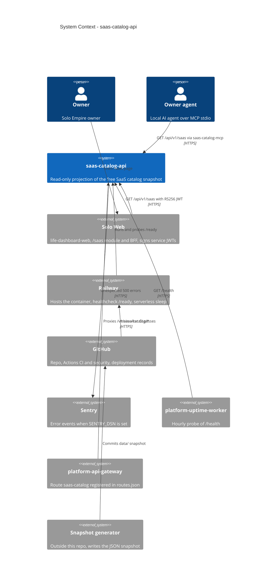

# 05 — C4 Context

หมายเหตุ: ไม่มีระบบ provider ภายนอกใด ๆ ใน context นี้ (API ไม่เรียก SaaS ที่อยู่ในแค็ตตาล็อก)

Sources: `server.py`, `saas_catalog_mcp.py`, `_sentry.py`, `.railway/railway.ts`, `.railway/railway.ts`, `README.md`, `PRODUCT.md`, platform-uptime-worker `src/targets.ts`, platform-api-gateway `routes.json` + `README.md`, Solo Web `lib/backends.ts` (all read-only)

## Open questions

- gateway ตรวจ token จาก issuer platform-identity / empire-platform แล้วส่ง token ต่อ แต่ API นี้รับเฉพาะ `iss` = Solo Web origin (`SAAS_CATALOG_API_AUTH_ISSUER`) ดังนั้น request ผ่าน gateway น่าจะได้ 401; มี consumer ใช้ route `saas-catalog` ของ gateway จริงหรือไม่
