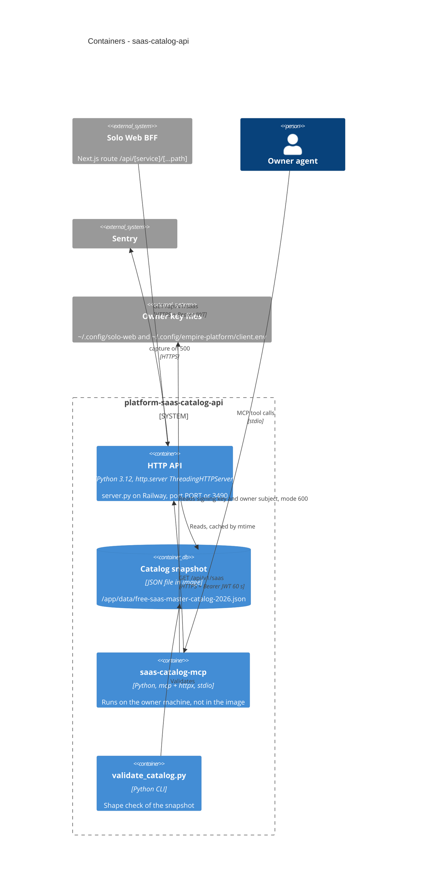

# 06 — C4 Container

Docker image มีแค่ `server.py`, `_sentry.py`, `pyproject.toml`, `uv.lock`, `vendor/service-auth` และไฟล์ snapshot (ไม่มี `saas_catalog_mcp.py` แม้จะอยู่ใน `py-modules`, ไม่มี optional `mcp` extra เพราะ `uv sync --no-dev` ไม่ใส่ extras)

Sources: `Dockerfile`, `pyproject.toml`, `server.py`, `saas_catalog_mcp.py`, `scripts/validate_catalog.py`, `_sentry.py`, `.mcp.json`
