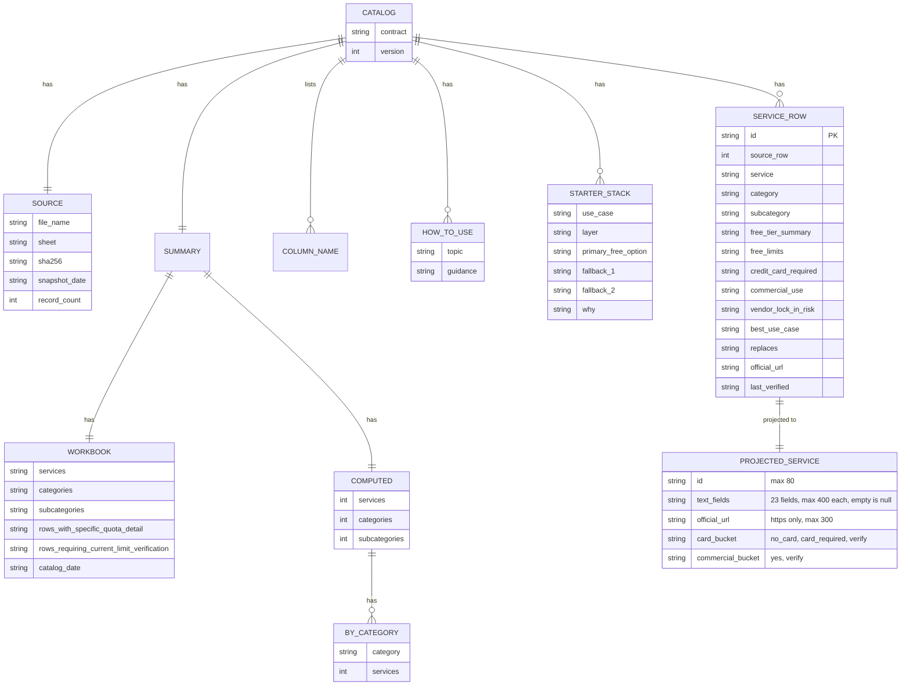

# 09 — ERD (snapshot file model)

ไม่มี database ข้อมูลที่ persist มีไฟล์เดียว: `data/free-saas-master-catalog-2026.json` (contract `solo-empire.free-saas-catalog.v1`, version 1) ERD ด้านล่างคือโครงสร้างไฟล์นั้น และ object ที่ API project ออกมา

`SERVICE_ROW` มี 26 คอลัมน์ (ตาม `columns`) ใน ERD แสดงเฉพาะที่ใช้ใน logic; คอลัมน์ที่เหลือ (`sleeps_pauses`, `bandwidth`, `storage`, `requests_compute`, `regions`, `custom_domain`, `api`, `open_standard_portability`, `overage_paid_entry`, `free_forever`, `self_host_alternative`, `notes`) ถูก project เป็น text field ตาม `TEXT_FIELDS` ส่วน `source_row` ไม่ถูกส่งออก API; `columns` และ `how_to_use` ไม่ถูก API อ่าน

ค่าปัจจุบัน: 648 services, 29 categories, 18 starter stacks, `snapshot_date` 2026-08-30 (คำนวณจากไฟล์ที่ `21d5d41`)

Sources: `data/free-saas-master-catalog-2026.json`, `server.py` (`TEXT_FIELDS`, `project_service`, `CatalogStore.snapshot`), `scripts/validate_catalog.py`, `service.yaml`, `contracts/saas-catalog.v1.md`

## Open questions

- ไม่มี JSON Schema ของ snapshot ใน repo; validator ตรวจแค่ contract, services ไม่ว่าง, id ไม่ซ้ำ
