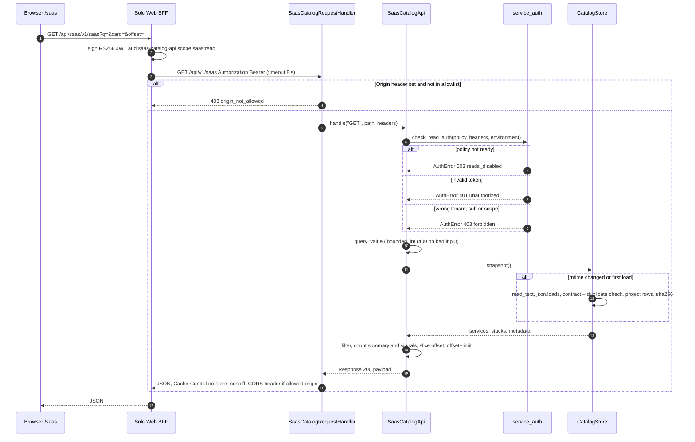
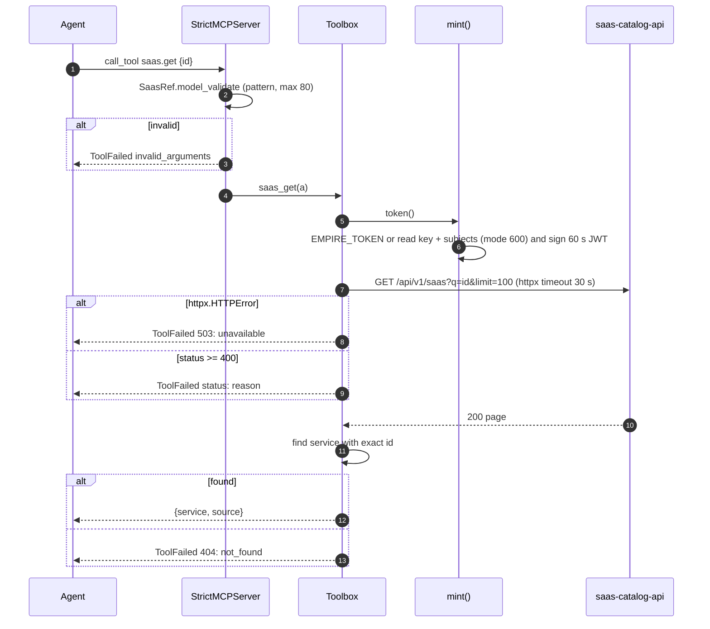
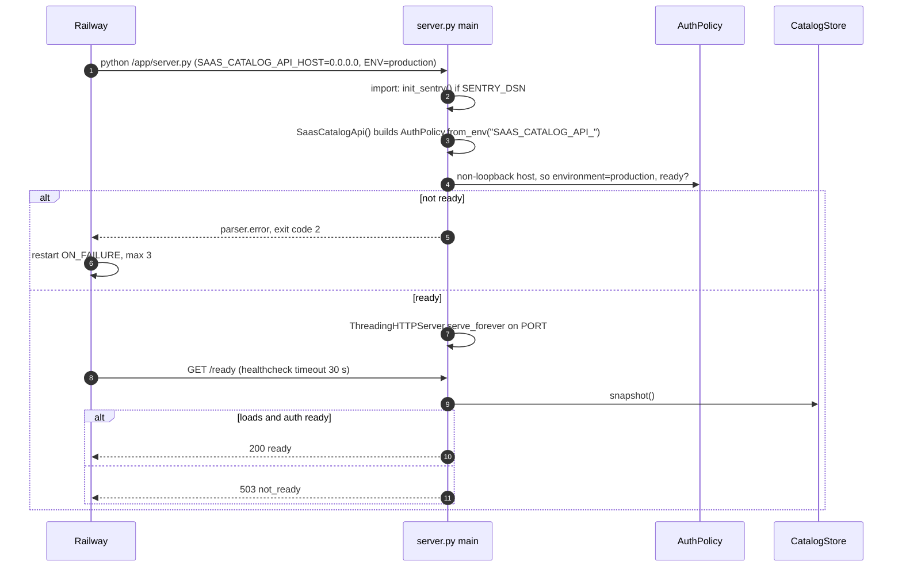

# 10 — Sequences

## S1 — Solo Web reads the catalog (happy path + error branches)

ไม่มี retry ทั้งฝั่ง server และ BFF ตามโค้ดที่อ่าน

Sources: `server.py`, `vendor/service-auth/service_auth/__init__.py`, Solo Web `lib/backends.ts`, `lib/auth.ts`, `modules/saas/api.ts` (read-only)

## S2 — MCP saas.get

Sources: `saas_catalog_mcp.py`, `tests/test_mcp.py`

## S3 — Startup and readiness on Railway

Sources: `server.py` (`main`), `Dockerfile`, `.railway/railway.ts`, `_sentry.py`, `vendor/service-auth/service_auth/__init__.py`
