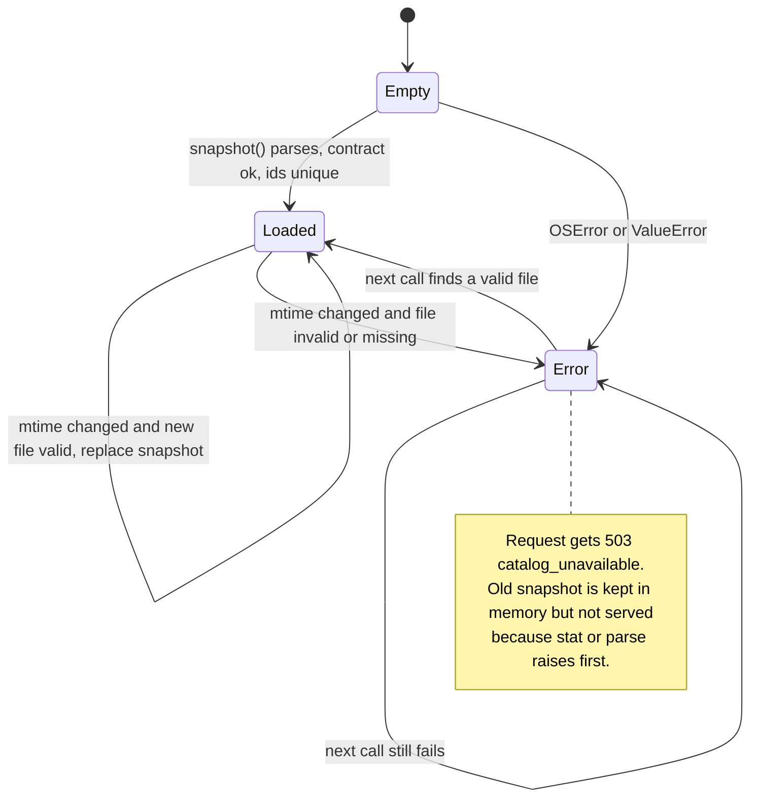
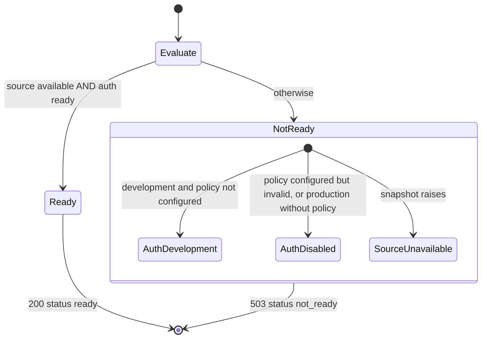
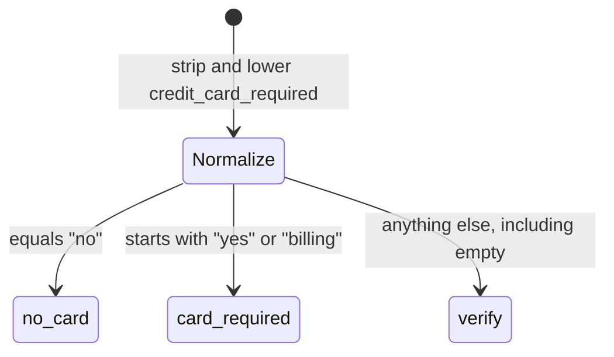
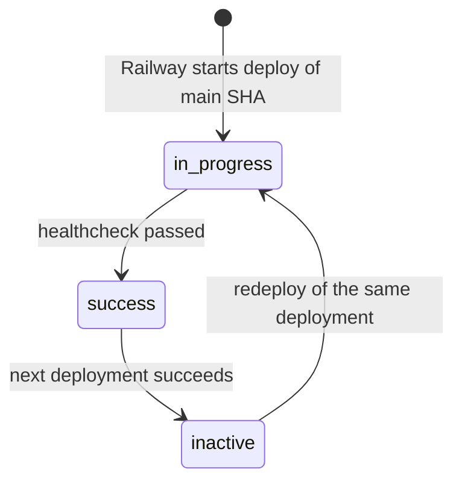

# 11 — State machines

ไม่มี entity ที่มี status field แบบ persisted (ไม่มี database) state ที่มีจริงในโค้ดคือ cache ของ snapshot, ผล readiness, การจัด bucket และ deployment status ที่ GitHub บันทึก

## CatalogStore cache

Sources: `server.py` (`CatalogStore.snapshot`, `handle` except branches), `tests/test_catalog_loading.py`

## Readiness (`GET /ready`)

`auth=development` ก็ยังได้ 503 เสมอ (`ready = source_ready and auth_ready`)

Sources: `vendor/service-auth/service_auth/__init__.py` (`readiness`), `tests/test_server.py::test_readiness_and_remote_bind_fail_closed`

## Card bucket classification

Sources: `server.py` (`card_bucket`, `commercial_bucket`), `tests/test_card_and_commercial_buckets.py`

## Production deployment record (GitHub deployments, Railway)

ค่าที่เห็นจริง: deployment `21d5d41` success 2026-10-24, inactive 2026-10-29 17:12 UTC, success อีกครั้ง 2026-10-30 18:48 UTC; ไม่เห็นสถานะ `failure` ใน 4 deployments

Sources: `gh api repos/bookchaowalit/platform-saas-catalog-api/deployments/<id>/statuses` (2026-11-04)

## Open questions

- อะไรทำให้ deployment `21d5d41` เป็น inactive 2026-10-29 แล้ว success ใหม่ 2026-10-30 (ไม่มี deployment record อื่นใน GitHub ช่วงนั้น: อาจเป็น redeploy/variable change ใน Railway)
