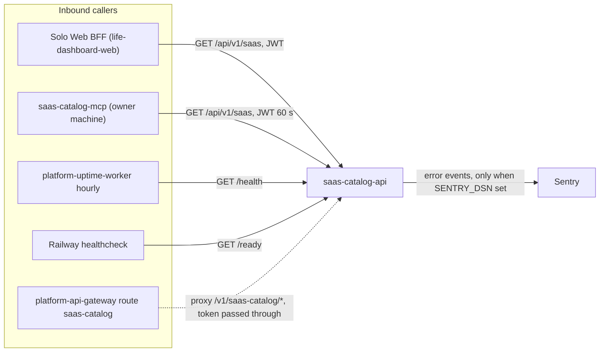

# 12 — API and integrations

Contract: [`contracts/saas-catalog.v1.md`](../../contracts/saas-catalog.v1.md) (reused; ไม่คัดลอกทั้งหมด) `schema_version: solo-empire.saas-catalog.v1`

## Endpoints (ตาม `SaasCatalogApi.handle`)

| Method | Path | Auth | Responses |
|---|---|---|---|
| `OPTIONS` | any path | none | 204, plus `Access-Control-Allow-Methods: GET, OPTIONS` and `Allow-Headers: Accept, Authorization` |
| `GET` | `/health` | none | 200 `{status: ok, service, schema_version, timestamp}` |
| `GET` | `/ready` | none | 200 `ready` / 503 `not_ready` with `source`, `auth` |
| `GET` | `/api/v1/saas` | JWT `saas:read` (production) | 200 overview; 400 `invalid_field` / `invalid_limit` / `invalid_offset`; 401; 403; 503 `reads_disabled` / `catalog_unavailable`; 500 `internal_error` |
| other method | `/api/v1/saas` | auth checked first | 405 `method_not_allowed` (after auth passes) |
| any | other path | none | 404 `not_found` |
| `HEAD` | any | — | 501 from stdlib (no `do_HEAD`) |
| any | any, with disallowed `Origin` | — | 403 `origin_not_allowed` (checked before routing, even `/health`) |

Trailing slash ถูกตัดก่อน match (`path.rstrip("/")`) Error envelope: `{"error": {"code", "message"}}`

Query `/api/v1/saas`: `category` (exact, ≤ 60), `card` ∈ `no_card|card_required|verify`, `commercial` ∈ `yes|verify`, `q` (≤ 80, casefold substring ใน id, service, subcategory, best_use_case, replaces), `limit` 1–100 default 30, `offset` 0–5000

## Integration flows

ไม่มี outbound integration อื่น: ไม่มี webhook, ไม่มี provider SDK, ไม่มี DB client ใน `server.py` (`sentry-sdk` เป็นตัวเดียวที่ออก network)

Sources: `server.py`, `saas_catalog_mcp.py`, `_sentry.py`, `.railway/railway.ts`, `contracts/saas-catalog.v1.md`, platform-uptime-worker `src/targets.ts`, platform-api-gateway `routes.json`, Solo Web `lib/backends.ts` (read-only)

## Open questions

- ค่า `SAAS_CATALOG_API_CORS_ORIGINS` ใน production (default ในโค้ดคือ `http://127.0.0.1:3600,http://localhost:3600`); BFF เรียกแบบ server-to-server จึงอาจไม่ส่ง `Origin`
- route gateway ใช้งานได้จริงหรือไม่ (ดู 05)
