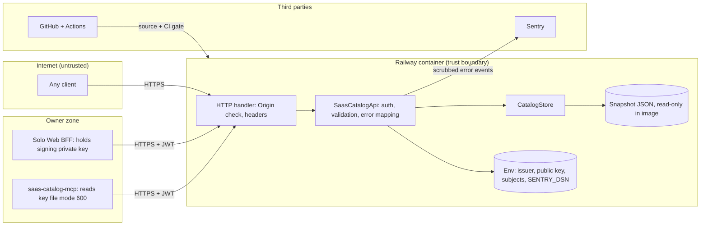

# 13 — Threat model (DFD + STRIDE)

## STRIDE

| Element | Threat | Mitigation in code | Gap |
|---|---|---|---|
| HTTP handler | **S** spoof caller | RS256 JWT, local PEM key ≥ 2048, fixed `aud`, `scope`, `tenant_id=owner`, sub allowlist; remote key headers rejected | static token path exists in development; guarded by non-loopback → production in `main` and Dockerfile `ENV=production` |
| HTTP handler | **T** tamper query | length limits (q 80, filters 60), int bounds, bucket enums | — |
| HTTP handler | **R** repudiation | — | no access log (`log_message` returns), no audit of who read; jti not stored |
| HTTP handler | **I** disclosure | `/health` and `/ready` show no rows or paths; errors are fixed text; `Cache-Control: no-store`, `nosniff`; CORS allowlist | `OPTIONS` answers 204 on any path without auth (headers only) |
| HTTP handler | **D** DoS | `limit` ≤ 100, `offset` ≤ 5000; ThreadingHTTPServer | no rate limit, no request timeout, unbounded threads; public `/health` wakes the serverless service |
| SaasCatalogApi | **E** elevation | read-only: only GET serves data, others 405; no write path | — |
| CatalogStore / snapshot | **T** poisoned snapshot | contract check, unique ids, https-only `official_url`, text cut to 400; validator script; CI security scans | no schema check of field content; origin of the snapshot is an external generator (owner unknown) |
| Env config | **I** key leak | only public key in service; signing key never in image (README); `.env.example` placeholders | partial config fails closed (`ready` false → 503) |
| Sentry flow | **I** PII leak | `send_default_pii=False`, no locals, no bodies, request reduced to method, scrub bearer/JWT/URL password, tracing off | — |
| MCP | **E** token misuse | token 60 s, fixed audience and scope, forbidden identity args, extra args rejected, key file must be mode 600, https or loopback only, no redirects | signing key can mint for every Solo Web service (README trade-off) |
| MCP | **I** error echo | `failure()` fixed text, transport error not echoed | — |
| CI / supply chain | **T** dependency | `uv.lock` frozen, action/workflow SHA pins, Renovate, osv-scanner, trivy-fs, semgrep, gitleaks | no branch protection on `main` (API 404 "Branch not protected"); vendored `service-auth` updated by hand |

Sources: `server.py`, `vendor/service-auth/service_auth/__init__.py`, `saas_catalog_mcp.py`, `_sentry.py`, `Dockerfile`, `.env.example`, `README.md`, `.github/workflows/ci.yml`, `renovate.json`, `gh api repos/bookchaowalit/platform-saas-catalog-api/branches/main/protection`

## Open questions

- ต้องการ rate limit หรือ access log หรือไม่ สำหรับ API สาธารณะที่ข้อมูลไม่ลับแต่ต้อง auth
- ใครอนุมัติ snapshot ใหม่ก่อน merge (ไม่มี PR review บังคับ)
