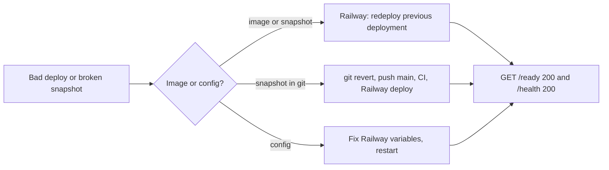

# 14 — Backup and DR

| Data | Where it lives | Backup reality | Restore |
|---|---|---|---|
| Catalog snapshot `data/free-saas-master-catalog-2026.json` | Git (GitHub `main`) and baked into each Docker image | Git history is the backup; `source.sha256` in the file is the workbook hash | redeploy an earlier Railway deployment, or revert the commit |
| Config (issuer, public key, subjects, CORS, `SENTRY_DSN`) | Railway service variables (`variables: { managed: false }`) | not in this repo; no backup found | re-enter from owner records |
| Source workbook `Free-SaaS-Master-Catalog-Expanded-2026.xlsx` | outside this repo | unknown | unknown |

ไม่มี database, ไม่มี volume, ไม่มี state ที่เขียนตอน runtime จึงไม่มี backup workflow ใน `.github/workflows/`

- RTO: not defined
- RPO: not defined (ข้อมูลอยู่ใน Git ทุก commit จึงไม่สูญหายจากการ deploy)

Sources: `service.yaml`, `Dockerfile`, `.railway/railway.ts`, `README.md` "Deploy", `data/free-saas-master-catalog-2026.json` (`source`), `.github/workflows/`

## Open questions

- Railway variables ถูกเก็บสำรองที่ไหน (เช่น Infisical) — repo นี้ไม่มีข้อมูล
- RTO / RPO ที่ owner ต้องการ
