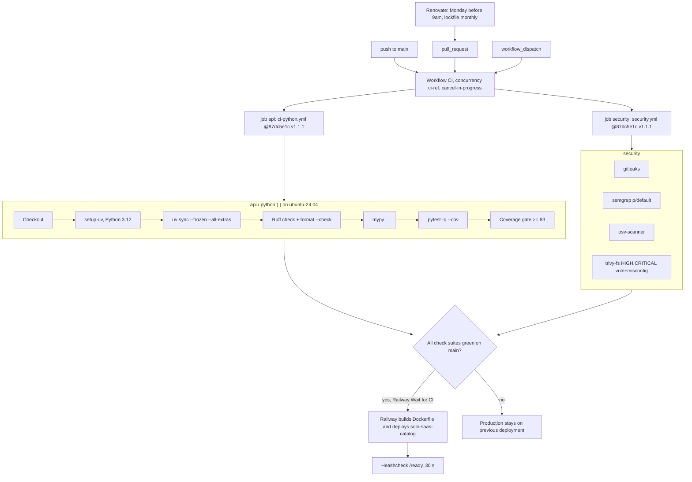

# 15 — CI/CD pipeline

Postgres step ของ `ci-python.yml` ไม่ทำงาน (`postgres` input ไม่ได้ตั้ง, default false) ผล 90 วัน: 14 runs, success ทั้งหมด (7 push main, 7 pull_request)

Sources: `.github/workflows/ci.yml`, platform-ci-workflows `.github/workflows/ci-python.yml` และ `security.yml` @ `87dc5e1c` (read-only), `renovate.json`, `.railway/railway.ts`, `.railway/railway.ts`, `README.md`, `gh run list -R bookchaowalit/platform-saas-catalog-api --limit 100`, `gh run view <latest> --json jobs`

## Open questions

- `scripts/validate_catalog.py` ไม่ใช่ step แยกใน CI (ถูกเรียกผ่าน test `test_committed_snapshot_has_valid_shape` เท่านั้น)
- Docker image ไม่ถูก build ใน CI (build ครั้งแรกคือบน Railway)
