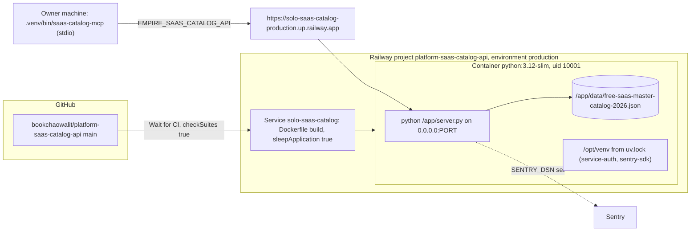

# 16 — Deployment

| Item | Value | Source |
|---|---|---|
| Healthcheck | `/ready`, 30 s | `.railway/railway.ts` |
| Restart | `ON_FAILURE`, max 3 | `.railway/railway.ts` |
| Docker HEALTHCHECK | every 15 s, timeout 3 s, 3 retries on `/ready` | `Dockerfile` |
| Env baked in image | `SAAS_CATALOG_API_HOST=0.0.0.0`, `SAAS_CATALOG_API_ENV=production` | `Dockerfile` |
| Runtime env | `SAAS_CATALOG_API_AUTH_ISSUER`, `_AUTH_PUBLIC_KEY`, `_AUTH_SUBJECTS`, `_CORS_ORIGINS`, optional `SENTRY_DSN`, `PORT` | `.env.example`, `README.md` |
| Region | Singapore (not in IaC; `railway scale` note) | `PRODUCT.md`, `.railway/railway.ts` |
| `service.yaml` `deploy.target` | `unassigned` (stale vs Railway reality) | `service.yaml` |

Live check 2026-11-04: `GET /health` 200, `GET /ready` 200, `GET /api/v1/saas` without token 401

Sources: `.railway/railway.ts`, `.railway/railway.ts`, `Dockerfile`, `.env.example`, `service.yaml`, `PRODUCT.md`, `README.md`, `.mcp.json`, `curl` of the production URL (2026-11-04)

## Open questions

- ไม่มี custom domain; ถ้า gateway จะเป็นทางเข้าหลักต้องแก้ issuer ที่ API ยอมรับ (ดู 05)
