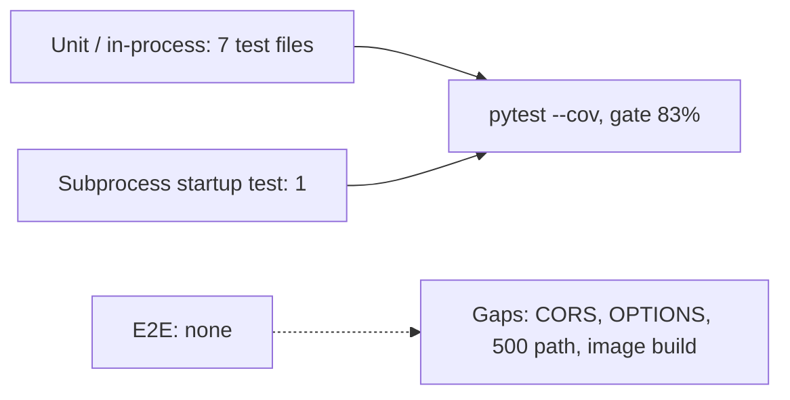

# 17 — Test coverage matrix

ทุก test ใน `tests/` เป็น unit / in-process API test (เรียก `SaasCatalogApi.handle` ตรง ๆ ด้วยไฟล์ catalog ชั่วคราว) ยกเว้น `test_readiness_and_remote_bind_fail_closed` ที่ spawn `server.py --host 0.0.0.0` เป็น subprocess เพื่อตรวจว่า exit 2 ไม่มี test ที่เปิด socket HTTP จริง และไม่มี e2e กับ Solo Web หรือ production

| Feature | Unit / in-process | Integration (process / real HTTP) | E2E | Test files |
|---|---|---|---|---|
| Card / commercial buckets | yes | — | — | `test_card_and_commercial_buckets.py`, `test_server.py::test_card_buckets` |
| Projection (cut, https url, nulls) | yes | — | — | `test_card_and_commercial_buckets.py` |
| Snapshot loading, contract, duplicates, reload by mtime | yes | — | — | `test_catalog_loading.py` |
| Shipped snapshot valid | yes | — | — | `test_catalog_loading.py::test_the_shipped_snapshot_loads_with_unique_ids`, `test_server.py::test_real_catalog_projects`, `test_validate_catalog.py::test_committed_snapshot_has_valid_shape` |
| Search, filters, paging bounds | yes | — | — | `test_search_and_paging.py`, `test_server.py::test_filters_and_paging` |
| Read-only 405 / 404 | yes | — | — | `test_catalog_loading.py::test_the_catalog_is_read_only`, `test_server.py::test_read_only_auth_and_failures` |
| JWT auth 401 / 403 / 503 | yes | — | — | `test_server.py::test_scoped_production_auth_and_safe_errors`, `::test_static_token_is_never_production_authorization` |
| Readiness states | yes | subprocess (startup refusal only) | — | `test_server.py::test_readiness_and_remote_bind_fail_closed` |
| service-auth verifier | in `vendor/service-auth/tests/test_auth.py` | — | — | not collected by CI (`testpaths = ["tests"]`) |
| MCP tools, arg validation, errors, minting | yes (fake httpx transport, throwaway key) | — | — | `test_mcp.py` |
| Validator CLI | yes | — | — | `test_validate_catalog.py` |
| Sentry init / scrub / capture | yes | — | — | `test_sentry.py` |
| CORS Origin allowlist, response headers, `OPTIONS` 204 | **gap** | **gap** | — | none |
| 500 `internal_error` path calls `capture` | **gap** | — | — | none |
| Docker image / Railway healthcheck | — | **gap** (not built in CI) | — | none |
| Solo Web → API contract | — | — | **gap** in this repo | Solo Web has `tests/service-auth-parity.test.ts` (other repo) |

Coverage gate: CI `coverage-threshold: "83"`; SPEC-001 records 85.71% on 2026-10-22; review 2026-10-24 records "102 passed, 7 subtests passed"

Sources: `tests/*.py`, `tests/conftest.py`, `vendor/service-auth/tests/test_auth.py`, `pyproject.toml` (`testpaths`, `coverage.run`), `.github/workflows/ci.yml`, `specs/001-l2-baseline/spec.md`
