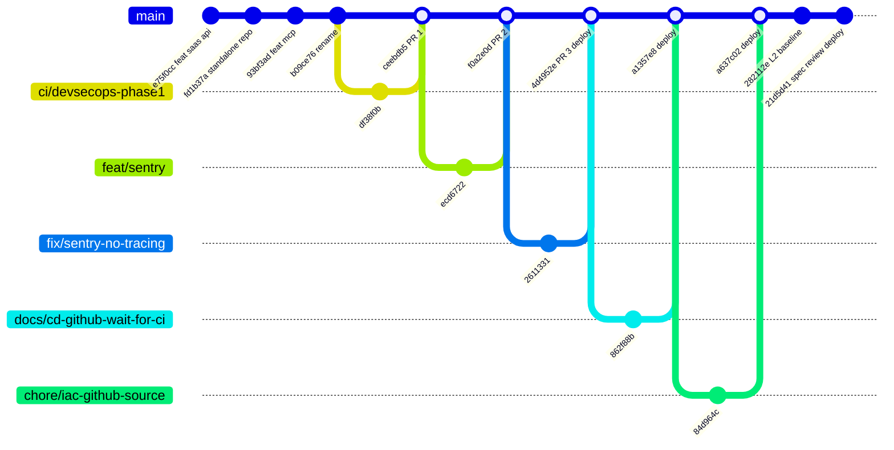
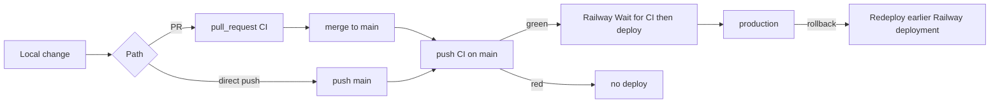

# 18 — Git and release workflow

ไม่มี branch protection บน `main` (`gh api .../branches/main/protection` → 404 "Branch not protected") ใน 90 วันมีทั้ง PR (#1–#5, 2026-10-17 → 18) และ commit ตรงเข้า `main` (เช่น `282112e`, `21d5d41` ตาม SPEC-001 "Main-only: yes") plus merge commits ของ branch local (`a1357e8`, `a637c02`)

gitGraph ย่อ commit ของแต่ละ branch เหลือ 1 จุด (feat/sentry มี 3 commits) PR #1–#3 ถูก squash merge (commit เดียวบน main มีเลข PR); #4–#5 เป็น merge commit (`Merge branch ...`) ไม่มี tag หรือ GitHub release

Sources: `git log --first-parent origin/main`, `gh pr list --state all`, `gh api .../branches/main/protection`, `gh api .../deployments`, `README.md` "Deploy", `.railway/railway.ts`, `specs/001-l2-baseline/spec.md`
