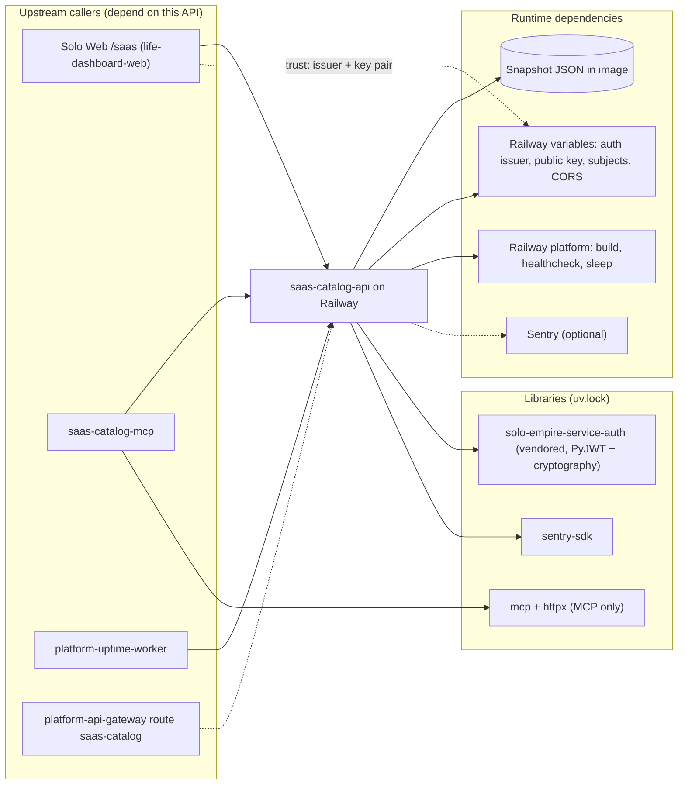

# 19 — Service dependency map

ไม่มี DB, cache, queue หรือ CDN API ทำงานได้ด้วย snapshot + env เท่านั้น; Sentry ล่มไม่กระทบ request (เรียกเฉพาะ path 500)

Sources: `server.py`, `_sentry.py`, `saas_catalog_mcp.py`, `pyproject.toml`, `uv.lock`, `Dockerfile`, `railway.toml`, platform-uptime-worker `src/targets.ts`, platform-api-gateway `routes.json`, Solo Web `lib/backends.ts` (read-only)
