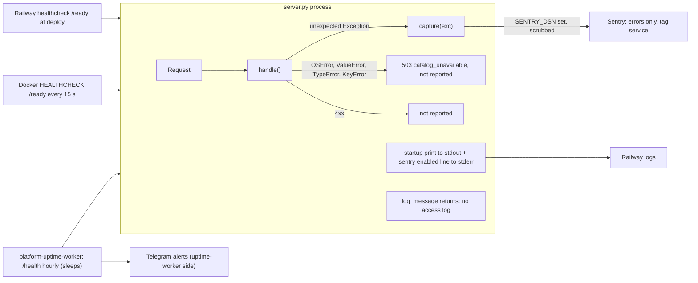

# 20 — Observability

| Signal | Implemented | What it watches | Gap |
|---|---|---|---|
| Sentry errors | yes, when `SENTRY_DSN` set | only the last-resort 500 path | 503 snapshot failures and auth misconfig (503 `reads_disabled`) are not sent |
| Tracing / metrics | no (`traces_sample_rate=None`) | — | no latency or request-rate data |
| Access / request logs | no (`log_message` suppressed) | — | 5xx rate in `PRODUCT.md` "Measures" cannot be computed from this service |
| Liveness | `/health` | process answers | does not check snapshot or auth |
| Readiness | `/ready` | snapshot parses AND auth ready | only Railway at deploy + Docker HEALTHCHECK use it; uptime-worker probes `/health` |
| Uptime | platform-uptime-worker target `saas-catalog-api`, group `own`, in the hourly sleeping set | `/health` 200 | readiness regressions after deploy are not caught |
| Heartbeat | none | — | not needed (no scheduled job) |
| Product analytics | none | — | — |

Sources: `server.py`, `_sentry.py`, `Dockerfile`, `.railway/railway.ts`, `PRODUCT.md` "Measures", platform-uptime-worker `src/targets.ts` (read-only)

## Open questions

- `SENTRY_DSN` ตั้งใน Railway แล้วหรือยัง (repo บอกเพียงว่า opt-in)
- ควรให้ uptime-worker probe `/ready` แทน `/health` หรือไม่
