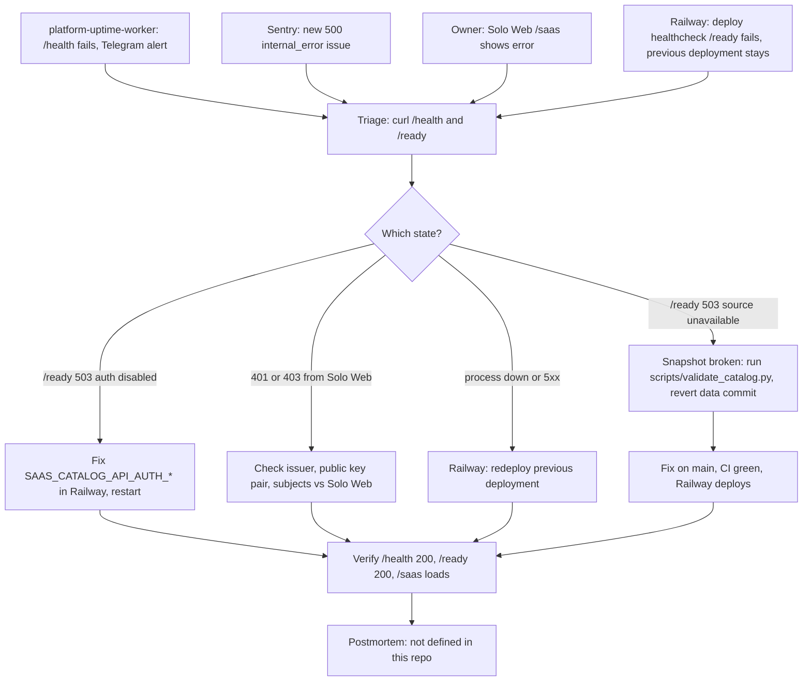

# 21 — Incident response

ไม่มี runbook เฉพาะ repo นี้ flow ด้านล่างประกอบจาก alert channel และ rollback ที่พบจริง

| Channel | Source |
|---|---|
| Telegram via platform-uptime-worker | platform-uptime-worker `src/targets.ts` (target `saas-catalog-api`) and its `README.md` (read-only) |
| Sentry | `_sentry.py`, `README.md` |
| Railway deploy result | `.railway/railway.ts`, `README.md` "Deploy" |

Sources: `README.md`, `.railway/railway.ts`, `_sentry.py`, `server.py`, `scripts/validate_catalog.py`, `vendor/service-auth/service_auth/__init__.py`, platform-uptime-worker `src/targets.ts` (read-only)

## Open questions

- ไม่มี postmortem template หรือ incident log ใน repo นี้; ใช้ของ central หรือไม่
- ใครรับ alert Sentry ของ project นี้ (ไม่มีข้อมูลใน repo)
