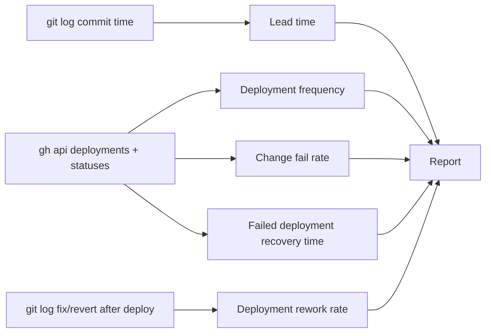

# 22 — DORA metrics

ช่วงวัด: 90 วันถึง 2026-11-04 (repo เริ่ม 2026-10-04 จึงมีข้อมูลจริง ~31 วัน) "Deployment" = GitHub deployment ของ environment `platform-saas-catalog-api / production` ที่ Railway สร้าง (มีตั้งแต่ CD 2026-10-18; ก่อนหน้านั้น deploy ด้วย `railway up` ซึ่งไม่มี record)



## Commands

```bash
gh api repos/bookchaowalit/platform-saas-catalog-api/deployments \
  --jq '.[] | [.id, .created_at, .environment, .sha[:7]] | @tsv'
gh api repos/bookchaowalit/platform-saas-catalog-api/deployments/<id>/statuses \
  --jq '.[] | [.created_at, .state] | @tsv'
gh run list -R bookchaowalit/platform-saas-catalog-api --limit 100 \
  --json createdAt,workflowName,event,headBranch,conclusion,headSha
git log --since=90.days --format='%h %cI %s' origin/main
git log --format='%h %cI' a637c02..21d5d41   # commits per deployment range
```

## Deployments (production)

| Deployment SHA | in_progress (UTC) | success (UTC) | Commits included | Lead time per commit (commit → success) |
|---|---|---|---|---|
| `4d4952e` | 2026-10-18 11:14:02 | 11:14:27 | `4d4952e` (first CD deploy) | 2 h 32 m |
| `a1357e8` | 2026-10-18 11:28:02 | 11:28:48 | `862f88b`, `a1357e8` | 6 m 35 s, 58 s |
| `a637c02` | 2026-10-18 14:10:39 | 14:11:31 | `84d964c`, `a637c02` | 2 m 17 s, 1 m 05 s |
| `21d5d41` | 2026-10-24 10:02:00 | 10:05:09 | `282112e`, `21d5d41` | 56 h 20 m, 6 m 53 s |
| `21d5d41` (same deployment again) | 2026-10-30 18:47:16 | 18:48:14 | none new | — |

## Results

| Metric | How measured here | Value (90 days) |
|---|---|---|
| Deployment frequency | count of production deployments with `success` | 4 deployments (3 on 2026-10-18, 1 on 2026-10-24) + 1 re-success of the same deployment on 2026-10-30; ≈ 1 per week since CD started |
| Lead time for changes | commit committer time → deployment `success` | median 6 m 35 s over 7 commits (range 58 s – 56 h 20 m; the 56 h one is `282112e`, pushed 2026-10-22 with no deployment until the next push) |
| Change fail rate | deployments that failed or were followed by a fix/revert of that change | 0 / 4 (no `failure` status; CI 14/14 success; no revert after 2026-10-18) |
| Failed deployment recovery time | time from failed deployment to next success | not computable: no failed deployment in the window |
| Deployment rework rate | deployments whose purpose is to fix a previous deployment | 0 / 4 by deployment record. Note: `4d4952e` fixes `f0a2e0d` (Sentry tracing) but `f0a2e0d` had no deployment record; revert pair `a9cc574` / `024a688` (2026-10-13) predates CD and was not recorded as deployments |

Sources: GitHub deployments API, `gh run list`, `git log` (all run 2026-11-04 against `origin/main` `21d5d41`), `README.md` "Deploy"

## Open questions

- ทำไม push `282112e` (2026-10-22 01:44 UTC, CI success) ไม่มี deployment record (Railway Wait for CI หรือ approval gate?)
- อะไรทำให้ deployment `21d5d41` เป็น inactive 2026-10-29 และ success อีกครั้ง 2026-10-30 (ไม่มี record ใน GitHub) — ถ้าเป็น deploy แบบอื่นใน Railway ตัวเลข deployment frequency จะต่ำกว่าความจริง
- deploy ก่อน 2026-10-18 (`railway up`) ไม่มี record จึงไม่นับ
